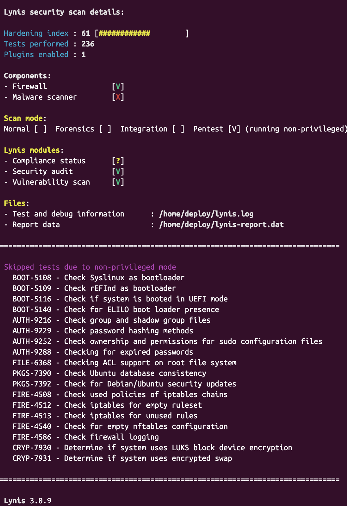
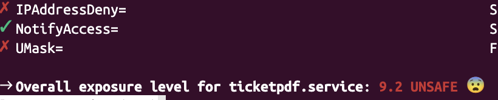
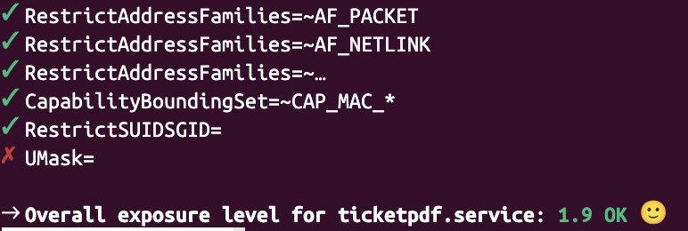
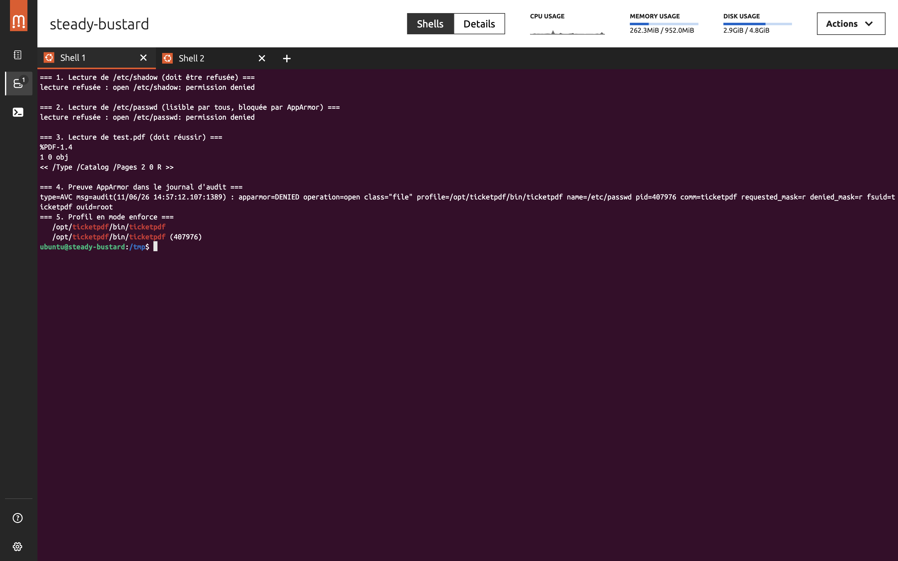
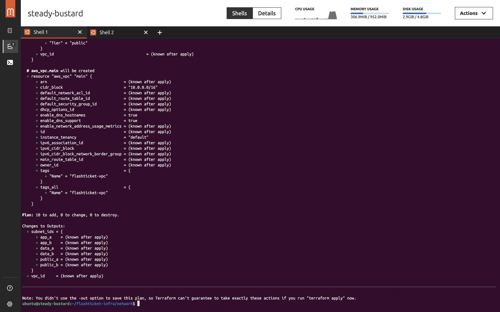

# Rapport J1 — durcissement FlashTicket

## Résultats avant / après

| Contrôle | Avant | Après |
|---|---:|---:|
| Lynis — hardening index | **61** (`media/lynis.png`) | **81** (`media/lynis-après.png`) |
| `systemd-analyze security ticketpdf.service` | **9,2 — UNSAFE** (`media/systemd.png`) | **1,9 — OK** (`media/systemd-apres.png`) |

### Capture Lynis avant / après

**Avant — score 61 :**



**Après — score 81 :**


Le hardening index Lynis progresse donc de **61 à 81**, soit **+20 points**.

### Captures systemd

**Avant :**



**Après :**



La baisse du score systemd vient notamment de `ProtectSystem=strict`,
`NoNewPrivileges`, `PrivateDevices`, `ProtectProc=invisible`,
`RestrictAddressFamilies` et de la suppression des capacités.

## AppArmor

La capture confirme :

- la lecture de `/etc/shadow` refusée (`permission denied`) ;
- la lecture de `test.pdf` autorisée ;
- une trace `apparmor="DENIED"` dans le journal ;
- le profil `/opt/ticketpdf/bin/ticketpdf` en mode `enforce`.



## Terraform

La capture montre un plan Terraform validé pour le réseau AWS :
**10 ressources à créer, 0 modification et 0 destruction**. Le VPC
`flashticket-vpc` utilise le bloc `10.0.0.0/16` et les sorties exposent les
sous-réseaux publics, applicatifs et de données.



## Schéma réseau (déduit de `vm/nftables.conf`)

```text
                         SSH/22
  Réseau public 192.168.252.1/32 ───► VM FlashTicket
                                      │ politique input : DROP
  Réseau applicatif 10.0.2.0/24 ─────► ticketpdf :8443
                                      │
                                      └─ sortie : ACCEPT
  autres entrées ────────────────────► DROP
```

Le forwarding est également en `DROP`. Le réseau public est repris tel qu’il
est écrit dans la configuration (`192.168.252.1`, avec un masque implicite
`/32`), et doit être vérifié/adapté à l’adresse réelle de l’hôte.