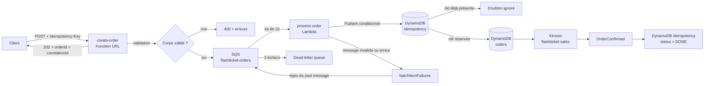
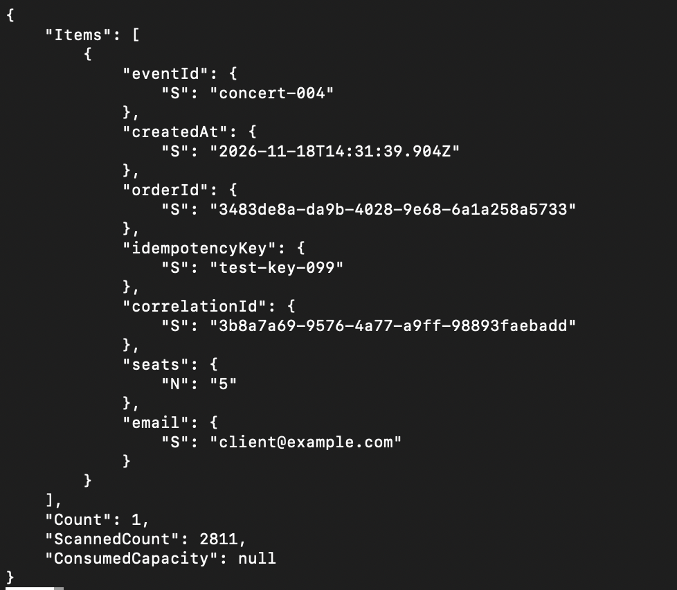

# Rapport J2 — prise de commande asynchrone

## 1. Schéma du flux



Le mapping SQS est configuré avec un lot maximal de 10 messages et
`ReportBatchItemFailures`. La Lambda renvoie donc uniquement les
`messageId` ayant échoué, au lieu de rejouer tout le lot.

## 2. Résultats des tests

- 5 envois avec l'`Idempotency-Key``

```shell
aws dynamodb scan \
  --table-name orders \
  --select ALL_ATTRIBUTES \
  --filter-expression "idempotencyKey = :key" \
  --expression-attribute-values '{":key":{"S":"test-key-099"}}' \
  --output json
```

résultat :


- DLQ et messages empoisonnés

```json
{
    "Messages": [
        {
            "MessageId": "a51aed2b-bc1d-4221-b0ed-92d65056adf3",
            "ReceiptHandle": "NGNlY2UzMjAtNGZmNS00NGEzLTkwNWUtNzVlZDQ4YTJmZDgzIGFybjphd3M6c3FzOmV1LX
dlc3QtMzowMDAwMDAwMDAwMDA6Zmxhc2h0aWNrZXQtb3JkZXJzLWRscSBhNTFhZWQyYi1iYzFkLTQyMjEtYjBlZC05MmQ2NTA1Nm
FkZjMgMTc5NTAxNDI4Mi4zNjkzNTMz",
            "MD5OfBody": "51b9fb5794bcd8b1ad34fd48a4c225f3",
            "Body": "{\"orderId\":\"6ebb7cae-c331-4ee8-af5d-d61784b2f4bf\",\"correlationId\":\"788b3
44e-b0e5-46e6-8de9-45702fb1b2dc\",\"idempotencyKey\":\"k6-21-3-1795009890327\",\"eventId\":\"concert
-2026\",\"seats\":qdfqsdf,\"email\":\"load@example.com\",\"createdAt\":\"2026-11-18T13:51:30.332Z\"}",
            "Attributes": {
                "SenderId": "000000000000",
                "SentTimestamp": "1795009890335",
                "ApproximateReceiveCount": "4",
                "DeadLetterQueueSourceArn": "arn:aws:sqs:eu-west-3:000000000000:flashticket-orders",
                "ApproximateFirstReceiveTimestamp": "1795014282369"
            }
        }
        ]
    }
```

### Résultat k6 observé

Les résultats sont ceux de [`loadtest/summary.json`](./loadtest/summary.json) :

| Indicateur             |          Valeur |
| ---------------------- | --------------: |
| Requêtes HTTP          |             825 |
| Réponses `202`         |   612 (74,18 %) |
| Échecs HTTP            |   213 (25,82 %) |
| Débit observé          | 3,93 requêtes/s |
| Durée du test          |         210,0 s |
| Latence moyenne        |         10,25 s |
| Latence médiane        |        16,51 ms |
| Latence p95            |        59,999 s |
| Itérations abandonnées |           2 470 |

Le scénario k6 visait 20 requêtes/s pendant 150 s, en plus de la montée en
charge. Le volume effectivement traité est donc inférieur à l'objectif et les
latences élevées ainsi que les itérations abandonnées indiquent une
saturation de l'environnement LocalStack pendant ce test.

### Cold start

Lors d'un démarage à froid, nous obtenons une réponse en environ 1,8 secondes, là ou une requete suivante ne prend que quelques milisecondes. La lanbda function n'ayant pas à regénérer son environnement.

### Count après k6

```shell
aws dynamodb scan --table-name orders --select COUNT --query Count
```

Résultat : `612`.

Ce résultat correspond aux 612 réponses `202` .
